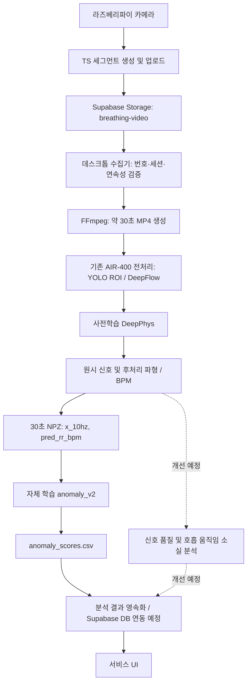
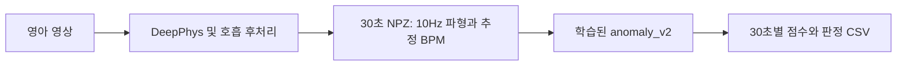

# AIR-400 기반 AIoT 베이비캠 — 전체 개발 인수인계

- 작성 기준: 2026-11-24 (한국 시간)
- 대상: ChatGPT Work 모드 또는 프로젝트를 처음 인수하는 개발자
- 목적: 라즈베리파이 영상 수집, Supabase Storage/DB 연동, DeepPhys 호흡 파형 추출, 자체 단일 클래스 이상 탐지 모델, 자동 연속 추론까지 맥락을 잃지 않고 이어서 구현·검증한다.
- 원칙: 이미 작동하는 모델과 환경을 불필요하게 재작성하거나 재학습하지 않는다. 확인된 사실, 사용자 보고, 기존 문서의 기록, 제안, 미검증 사항을 분리한다.

> **Work 모드에 전달할 핵심 요청:** 기존 AIR-400 로컬 프로젝트의 파일 및 환경을 먼저 확인하고, 실제 Supabase Storage 경로에서 연속 TS를 수집하여 시간 연속성을 검증한 뒤 30초 영상 단위로 기존 `air400_detect_v2.py`에 전달한다. 실제 DB 스키마와 권한을 확인하고, 기존 앱 구조에 맞게 결과를 기록하도록 연결한다. 먼저 단일 배치의 end-to-end 성공을 재현하고, 이후 자동 실행·재시도·처리 지연·결과 저장을 보완한다. 추측으로 DB 스키마를 만들거나 기존 데이터를 변경하지 않는다.

## 0. 현재 상태 요약 및 근거 수준

| 구성 요소 | 상태 | 근거 및 한계 |
|---|---|---|
| 라즈베리파이 카메라 → Supabase Storage | 사용자 보고상 구현됨 | 실제 Storage에서 받은 TS 샘플 제공. 업로드 코드, 연결 방식, 실제 현재 목록, manifest 존재는 아직 미확인 |
| TS 포맷 | 첨부 파일 직접 검사 완료 | H.264, MPEG-TS, 1280×960, 10 FPS, 20프레임, 1.999600초 |
| TS → MP4 결합 | 단일 샘플 반복 결합 시험 성공 | 동일 샘플 15회 연결 결과 29.994초/300프레임 정상 디코딩. 실제 서로 다른 연속 TS 15개로 성공한 것은 아님 |
| Windows DeepPhys 추론 | 사용자 보고상 파형 출력 성공 | 초기 오류와 수정 기록 있음. 현재 데스크톱의 최신 환경 및 동일 설정으로 재현 여부는 확인 필요 |
| DeepPhys 훈련용 NPZ | 실제 파일 확인 완료 | 샘플 `000000.npz`에서 7개 키 확인. 전체 데이터 품질·정상 라벨은 미확인 |
| 이상 탐지 `anomaly_v2` | 기존 인수인계 문서상 코드 및 합성 테스트 있음 | 사용자가 모델을 만들었다고 보고함. 실제 체크포인트, 손실곡선, 평가 CSV, 코드 자체는 현재 첨부되지 않음 |
| Storage 자동 수집기 `storage_inference.py` | 대화에서 예시 코드 제안됨 | 실제 파일 존재·연결·실행 여부 미확인. 이전 예시의 SDK 예외 처리 및 타임아웃은 검증 필요 |
| Supabase DB 결과 쓰기 | 제안 단계, 구현 확인 불가 | Storage 연결과 DB 기록은 별개. 프로젝트 URL, 실제 테이블/컬럼, RLS 정책, 기존 결과 저장 코드는 제공되지 않음 |
| 실시간 30초 간격 추론 | 목표 | 기존 DeepFlow CPU 병목, 실제 처리 속도/지연 측정 필요 |
| 무호흡 탐지 | 목표 및 개선안 단계 | `anomaly_v2`는 일반 이상 점수 모델이며 무호흡 검증·임상 라벨·별도 분기 구현은 확인되지 않음 |

### 자료와 근거

- 사용자와의 이전 대화: Windows 오류 해결, DeepPhys 파형 추출, 30초 NPZ, 단일 클래스 모델, Supabase Storage 연결 논의.
- 첨부 `AIR400_MODEL_HANDOFF(1).md`: v1/v2 구조, 학습·추론 CLI, 상태와 검증 범위. 원문을 문서 맨 뒤 부록에 포함했다.
- 첨부 `000000.npz`: NumPy로 직접 로드하여 실제 키·shape·dtype·메타데이터 확인.
- 첨부 `000000000210.ts`: `ffprobe` 및 FFmpeg로 직접 검사·반복 결합 시험.
- 첨부 `inference_20261111_182549.log`: 당시 DeepPhys 체크포인트 로딩, 얼굴 ROI 가중치 경로 오류, DeepFlow 전처리 로그가 기록되어 있다.
- 공식 AIR-400 저장소: https://github.com/michaelwwan/air-400

현재 문서에는 API 키, 토큰, 비밀번호를 넣지 않았다. Work 모드는 실제 프로젝트 및 로컬 환경을 확인하고, 필요한 경우 권한 있는 연결을 사용자에게 요청해야 한다.

## 1. 프로젝트 목적 및 범위

영아 수면 영상에서 호흡 움직임에 따른 신호를 추출하고, 정상 호흡 패턴과 다른 구간을 탐지하여 검토용 이상 결과를 제공하는 AIoT 베이비캠을 개발 중이다. 야간 적외선 카메라를 고려한다. 사용자의 목표에는 불규칙 호흡, 비정상적인 호흡 패턴뿐 아니라 호흡 움직임 소실(무호흡 의심)도 포함된다.

- 라즈베리파이: 카메라 영상 송출 및 세그먼트 업로드.
- Supabase Storage: 영상 세그먼트 보관. 실제 버킷과 prefix는 아래에 명시.
- Windows 데스크톱: 영상 수집, FFmpeg 결합, YOLO ROI 검출, Optical Flow, DeepPhys 파형 추출, 자체 이상 탐지 모델 추론.
- Supabase DB 또는 기존 서비스 백엔드: 분석 결과 저장 및 앱 표시 연동 예정. 기존 DB 구조는 아직 확보되지 않았다.
- 30초 분석이 현재 모델의 기본 단위다. 5~10초 갱신은 확장 목표이며 지금 바로 필수로 구현할 필요는 없다.

**안전상 범위:** 영상 기반 호흡 움직임 추정은 공기 흐름, 산소포화도, 실제 환기량을 직접 측정하는 기술이 아니다. 의료용 무호흡 판정기나 SIDS 예방 장치로 간주하면 안 된다. `below_threshold`를 임상적 정상으로 해석하지 말고, `unscored`를 안전 상태로 해석하지 않는다. 폐쇄성 무호흡은 호흡 운동이 계속될 수 있으므로 카메라만으로 배제할 수 없다. 실제 영아에게 안전 경보를 제공하려면 별도 센서·임상 기준 데이터로 검증해야 한다.

## 2. 전체 시스템 구조



파이프라인의 원칙은 수집과 추론을 분리하는 것이다. 초기 단일 배치 시험은 동기적 CLI 호출로 충분하나, 계속 동작하는 시스템에서는 수집기, 작업 큐, 모델 추론 워커, 결과 저장을 분리한다. `DeepPhys`와 `anomaly_v2`를 동시에 재학습할 계획은 없다.

## 3. 실제 환경과 프로젝트 파일

### 3.1 로컬 개발 환경

- OS: Windows, PowerShell 사용.
- 현재 프로젝트 루트로 알려진 경로: `C:\Users\OHS\air-400`.
- 이전 다른 컴퓨터에서는 `C:\Users\zz900\air-400`과 Conda `air400` 환경을 사용했다. 데스크톱에서 절대경로를 그대로 복사하지 않는다.
- 사용자 이전 데스크톱 사양: Ryzen 5 5600X, RTX 2060, RAM 32GB. 실제 GPU 인식 및 현재 사양은 재확인.
- 과거 성공 환경으로 안내한 조합: Python 3.12 + PyTorch 2.8.0 + torchvision 0.23.0, OpenCV contrib.
- 기존 모델 인수인계 문서의 최신 명령 예시는 `C:\Python314\python.exe`를 사용한다. 이는 Python 3.12 환경과 별개의 실행 환경일 수 있다. Python 3.14를 강제하거나 Conda를 삭제하지 말고, **실제 해당 스크립트와 가중치가 동작하는 Python 실행 파일을 확인한 후 같은 실행 파일을 일관되게 사용**한다.
- FFmpeg 및 ffprobe는 PATH에 등록하거나 명시적인 절대 경로를 설정해야 한다.

### 3.2 기대 파일 배치 (실제 위치 확인 필요)

```text
air-400/
├── infer.py                                 # AIR-400 기본 추론 진입점
├── configs/inference/deepphys_deep_infer.yaml
├── dataloaders/inference_dataset.py
├── processors/pre_processor.py
├── processors/post_processor.py
├── models/
│   ├── deep_phys.py                         # 사전학습 호흡 추출 모델
│   ├── air400_anomaly.py                     # 초기 실험
│   ├── air400_npz_anomaly.py                 # v1
│   ├── air400_npz_anomaly_v2.py              # v2 학습 스크립트
│   └── air400_detect_v2.py                   # v2 video/npz 추론 스크립트
├── checkpoints/DeepPhys_Deep_Body_best.pth
├── detectors/                               # 또는 checkpoints/ (실제 경로 확인)
│   ├── yolov8m.pt
│   └── yolov8n-face.pt
├── data/AIR_125/S01/002.mp4                   # 첨부 NPZ 메타데이터에 기록된 예
├── output/
│   ├── training_30s/windows/                 # 영상별 NPZ, PNG 하위 디렉터리
│   ├── ae_results_v2/air400_ae.pt
│   ├── ae_results_v2/splits.csv
│   ├── ae_results_v2/valid_scores.csv
│   └── ae_results_v2/test_scores.csv
├── storage_inference.py                     # 제안된 새 수집기, 존재 미확인
└── stream_batches/                          # 제안된 로컬 배치 작업 경로
```

### 3.3 초기 설치 및 해결한 Windows 오류

`conda env create -f environment.yml` 실행 시 다음 오류가 발생했다.

```text
LibMambaUnsatisfiableError: nothing provides gifsicle needed by pygifsicle-1.1.0-pyhd8ed1ab_0
```

이전에 원본 환경 전체 설치 과정에서 `gdk-pixbuf` CP949 관련 문제와 `pyflow`, PyTorch 패키지 관련 문제가 보고됐다. 당시에는 전체 의존성을 억지로 설치하지 않고 DeepPhys 추론에 필요한 환경을 구성하는 방향을 선택했다. 새 데스크톱에서도 `ModuleNotFoundError: No module named 'h5py'`가 발생해 해당 패키지 설치를 안내했다.

기존 실행 환경이 없을 때에만 다음을 참고한다. 아래 명령은 과거 안내 예시이며 현재 설치된 버전과 드라이버, 최신 저장소 import 목록을 확인 후 사용한다.

```powershell
conda create -n air400 python=3.12 pip -y
conda activate air400
nvidia-smi
# GPU 드라이버와 호환되는 경우에 한하여 과거 안내한 CUDA 빌드
python -m pip install torch==2.8.0 torchvision==0.23.0 --index-url https://download.pytorch.org/whl/cu126
python -m pip install numpy scipy h5py matplotlib pyyaml tqdm ultralytics==8.3.96
python -m pip install opencv-contrib-python==4.11.0.86
python -c "import torch,cv2,h5py; print(torch.__version__); print(torch.cuda.is_available()); print(cv2.optflow.createOptFlow_DeepFlow())"
```

OpenCV 패키지들은 동일 `cv2` 모듈을 공유하므로 `opencv-python`과 `opencv-contrib-python` 중복 설치로 모듈이 덮이는 문제가 없는지 확인한다. `ultralytics` 등 다른 패키지가 일반 OpenCV를 의존성으로 설치할 수 있다. 작동하는 환경을 불필요하게 재설치하지 말고 `pip list`, import 검사 및 `cv2.__file__`로 확인한다. `pyflow`는 다른 optical flow backend에서 필요할 수 있으며 DeepFlow 경로를 사용할 때만 불필요한 import 제거를 고려한다. `main.py` 등 간접 import 의존성도 실제 코드에서 확인할 것.

| 오류/현상 | 이전 대응 |
|---|---|
| `pygifsicle` 의존 패키지 `gifsicle` 부재 | 원본 환경 전체 설치 대신 필요한 의존성 설치 |
| `import pyflow` 오류 | DeepFlow 전용 경로라면 `processors/pre_processor.py`의 무조건적 import를 주석 처리 (다른 backend는 영향 가능) |
| Windows에서 로그 파일명에 콜론 | `datetime.now().strftime('%Y%m%d_%H%M%S')` 사용 |
| GPU 체크포인트를 CPU 환경에서 로딩 실패 | `torch.load(ckpt_path, map_location='cpu', weights_only=True)` 후 모델을 추론 장치로 이동 |
| YOLO 모델 파일 경로 오류 | `DATA_PATH.BODY_DETECTOR_PATH`, `FACE_DETECTOR_PATH`를 실제 로컬 파일 경로로 수정. `/detectors/...` 금지 |
| DataLoader multiprocessing `_thread.lock` pickle 오류 | Windows에서 `num_workers=0` 사용, 필요 시 `worker_init_fn` 제거 |
| `models/deep_phys.py` `.view()` stride 오류 | `d9 = d8.reshape(d8.size(0), -1)`로 대체 |
| `h5py` 누락 | 해당 Python 환경에서 `python -m pip install h5py` |
| DeepFlow 미존재 | 실행하는 Python에서 contrib OpenCV 확인 |
| `[WinError 2]` | FFmpeg 실행 파일/입력 경로 확인 필요. 실제 원인 및 최종 해결은 문서상 미확인 |

원래 단일 영상 실행 명령:

```powershell
python infer.py --config configs/inference/deepphys_deep_infer.yaml --checkpoint checkpoints/DeepPhys_Deep_Body_best.pth
```

## 4. AIR-400 및 DeepPhys의 역할과 데이터 처리

공식 저장소 및 이전 코드 확인에 따르면 `infer.py`는 `InferenceDataset`으로 영상 전체를 읽고 전처리한 다음 `DataLoader` 및 `run_inference()`로 모델 예측을 취합하고 `PostProcessor`를 거쳐 파일을 저장한다. DeepPhys가 고정 60초 영상 자체를 반드시 요구한다는 근거는 없다. 기존 일괄 처리 구조 때문에 영상 전체 추론 후 결과가 나온다.

주요 YAML(업스트림 예시; 현재 사용 YAML을 재확인):

```yaml
MODEL:
  NAME: DeepPhys
  FRAME_DEPTH: 10
  IN_CHANNELS: 3
TEST:
  DATA:
    INFANT_FLAG: True
    DATA_FORMAT: NDCHW
    PREPROCESS:
      DO_DOWNSAMPLE_BEFORE_PREPROCESS: True
      DOWNSAMPLE_SIZE_BEFORE_PREPROCESS: [320, 180]
      DATA_NORMALIZE_TYPE: Standardized
      LABEL_NORMALIZE_TYPE: DiffNormalized
      FLOW_NORMALIZE_TYPE: Standardized
      DO_CHUNK: True
      CHUNK_LENGTH: 180
      DO_CROP_INFANT_REGION: True
      DYNAMIC_DETECTION: True
      DYNAMIC_DETECTION_FREQUENCY: 10
      INFANT_REGION: Body
      DO_OPTICAL_FLOW: True
      OF_METHOD: deep
      DO_DOWNSAMPLE_BEFORE_TRAINING: True
      DOWNSAMPLE_SIZE_BEFORE_TRAINING: [96, 96]
INFERENCE:
  BATCH_SIZE: 8
  EVALUATION_METHOD: FFT
```

`CHUNK_LENGTH`는 초가 아닌 프레임 단위다. 기본 `_chunk()`는 정수 개수의 청크만 만들고 나머지 프레임을 버린다. 공식 `infer.py`의 청크 길이를 30초에 해당하도록 바꾸는 것만으로 스트리밍이 되지는 않는다. 현재 자체 v2 영상 추론기가 30초 단위 450프레임을 별도로 처리한다는 문서 기록을 우선한다. 새로 학습 NPZ를 만들 때 실제 extractor와 v2 영상 모드 간 전처리/프레임 드롭/시간 정렬 차이를 검증해야 한다.

### 4.1 DeepPhys 직접 출력과 후처리

- 직접 출력: 프레임별 원시 예측 신호 (`pred = model(data)`). 현재 설정의 `DiffNormalized`에 따라 호흡 신호의 차분 성분으로 해석되는 값. 실제 공기량이나 물리 단위가 아니다.
- 후처리: 원시 출력 누적합(`np.cumsum`), 추세 제거, 영아용 0.3~1.0Hz 대역 통과 필터, FFT 기반 지배 주파수에서 BPM 추정.
- 영아 BPM 필터 범위는 18~60 BPM에 해당한다. 필터 밖 성분이 약해지고 FFT가 정해진 범위에서 피크를 고르므로 극단적 호흡수·무호흡을 이 값만으로 확인할 수 없다. 노이즈에도 그럴듯한 BPM이 나올 수 있다.
- 기본 저장 파일: `*_pred.hdf5` (`time_sec`, `respiration`), `*_pred.png`, `*_result.json`, `summary_*.json`.
- 기본 `infer.py`는 원시 모델 출력을 별도 저장하지 않는다. 하지만 **현재 자체 NPZ에는 이미 `raw_model`이 있다.** 원시 출력 확보를 위해 전체 추론을 다시 하지 말고 기존 NPZ를 활용한다.
- DeepFlow는 OpenCV `cv2.optflow.createOptFlow_DeepFlow()` CPU 경로를 사용한다. PyTorch CUDA 사용만으로 DeepFlow 병목이 해결되지 않는다.

### 4.2 데이터셋

AIR-125 및 AIR-400 원본 영상과 동기화된 기준 호흡 신호를 활용하려고 했다. 정확한 다운로드 구조, 권리/사용 조건, 영상별 기준 신호 키와 주석은 원본 데이터 및 공식 저장소로 검증해야 한다. `AIR_125`와 `AIR_400` 사이의 S번호가 실제로 동일 영아인지 별도 확인 필요. RGB/IR 여부도 데이터별로 확인한다. 실제 정상 호흡 여부를 검토하지 않은 데이터를 자동으로 정상이라고 간주하면 안 된다.

## 5. 30초 NPZ 데이터 규격 (실제 파일 확인)

직접 검사한 `000000.npz`의 결과는 다음과 같다.

| Key | shape | dtype | 의미 |
|---|---|---|---|
| `raw_model` | `(450,)` | float32 | 15 Hz DeepPhys 원시 출력 |
| `respiration` | `(450,)` | float32 | 15 Hz 후처리 파형 |
| `time_sec` | `(450,)` | float64 | 0초부터 29.933333초까지 1/15초 간격 |
| `fs` | 스칼라 `()` | int64 | 15 |
| `x_10hz` | `(300,)` | float32 | 10 Hz × 30초, 자체 모델 파형 입력 |
| `pred_rr_bpm` | 스칼라 `()` | float64 | 33.3984375 (DeepPhys 추정값) |
| `metadata_json` | 스칼라 `()` | Unicode 문자열 | JSON 메타데이터 |

실제 메타데이터 (긴 해시값 생략, 나머지 실제 필드명 유지):

```json
{
  "video_id": "AIR_125_S01_002",
  "subject_id": "AIR_125:S01",
  "video": "C:\\Users\\OHS\\air-400\\data\\AIR_125\\S01\\002.mp4",
  "start_sec": 0,
  "end_sec": 30,
  "source_fps": 15.0,
  "samples": 300,
  "bpm_estimate": 33.3984375,
  "waveform_std": 0.6250197046586469,
  "label_status": "unreviewed",
  "window_file": "windows/AIR_125_S01_002/000000.npz",
  "source_sha256": "(실제 파일에 SHA-256 저장)",
  "run_signature": "(실제 파일에 추출 설정 서명 저장)"
}
```

**중요:** `label_status`가 `unreviewed`이므로 이 구간의 임상적 정상 라벨이 확인되지 않았다. `pred_rr_bpm`도 정답 센서 BPM이 아니다. `raw_model`과 `respiration`의 의미 및 시간 정렬은 추출 코드에서 검증한다.

파일 검사 코드:

```python
import json
import numpy as np
with np.load('000000.npz', allow_pickle=False) as d:
    for key in d.files:
        print(key, d[key].shape, d[key].dtype)
    meta = json.loads(d['metadata_json'].item())
    x = d['x_10hz'].astype(np.float32).reshape(1, 1, 300)
    bpm = float(d['pred_rr_bpm'])
    raw = d['raw_model']
print(meta, x.shape, bpm, raw.shape)
```

학습 코드가 NPZ 하위 폴더를 재귀 탐색하므로 초기 `X.npy`, `bpm.npy`, `metadata.csv`를 반드시 만들 필요는 없다. 30초 파형을 여러 개 생성했다는 사용자 보고는 있으나 전체 샘플 개수·영아별 분포·겹침 stride·정상 라벨 비율은 미확인이다. 이전에는 30초 길이/5초 stride를 제안했고 현재 v2 `video` 모드는 겹치지 않는 30초 단위로 기록되어 있다. 실제 학습 추출기의 설정과 비교해야 한다.

## 6. 단일 클래스 이상 탐지 모델 `anomaly_v2`

자세한 설계는 부록 A(기존 모델 인수인계 원문) 참조. 핵심은 다음과 같다.

### 6.1 목적 및 입력

- 정상 호흡으로 확인된 파형만으로 Autoencoder를 학습하고, 정상 패턴 복원 오차를 이용해 이상 후보를 찾는다.
- 파형 입력: `x_10hz` → `(B, 1, 300)`.
- 보조 BPM: `pred_rr_bpm` → `(B, 1)`.
- `raw_model`, 15 Hz `respiration`, 메타데이터는 현재 v2 직접 모델 입력이 아니다. 무호흡·품질 평가 확장에 활용할 수 있다.
- 학습용 통계로만 표준화한다. 윈도우마다 개별 Z-score로 진폭을 강제로 통일하지 않는다. 다만 DeepPhys 전처리 자체의 정규화가 진폭 해석에 미치는 영향을 고려해야 한다.
- 초기 정상 라벨이 없다면 `--all-normal`은 실험적 가정일 뿐, 실제 정상 학습으로 주장하지 않는다.

### 6.2 모델 구조

```text
x: (B, 1, 300)
  -> CNN Encoder (B,16,150) -> (B,24,50) -> (B,2,50)
  -> BPM을 50 시점에 반복 결합 (B,3,50)
  -> CNN Decoder 및 Upsampling x3, x2 -> (B,1,300)

Encoder의 2채널 latent에서 lag 1~5 자기상관 특징 10개
  -> MLP 10 -> 32 -> 1 -> 표준화 BPM 예측
```

BPM 예측 헤드에는 입력 BPM을 직접 주지 않아 복사 경로를 방지한다. 하지만 파형 디코더에는 입력 BPM이 들어가며, 이 조건부 복원이 비정상 BPM을 복원하는 문제는 실험해야 한다. BPM과 파형은 동일 DeepPhys 신호로부터 파생된 정보다.

- 학습: AdamW(lr=5e-4, weight_decay=1e-3), batch 64, 최대 1000 epoch, 기본 patience 2, 파형에만 학습 중 Gaussian noise std=0.05.
- 손실/이상점수: `wave_mse + 0.2 * bpm_mse` (모두 표준화 기준).
- 최저 `val_loss`의 가중치 복원, 정상 validation 점수 99백분위수(`method='higher'`)를 임계값으로 선택.
- `anomaly_score > threshold`만 이상 후보. 동일 값은 임계값 이하.
- 영아 단위 70/15/15 분리, seed 42. 정상 train/valid를 확보한다. test는 정상만 거르지 않고 유효 구간을 점수화한다.
- 실제 성능 미확인. 합성 테스트에서 v1 0.190740, v2 0.145974 최저 검증 손실이 기록되었으나 탐지 정확도 향상을 입증하지는 않는다.

### 6.3 실행 방법

기존 인수인계 문서의 예시를 현재 Python에 맞게 실행한다.

```powershell
Set-Location 'C:\Users\OHS\air-400'
# 실제 작동하는 환경에서 실행. Conda 환경을 사용한다면 해당 python 경로 확인.
$py = (Get-Command python).Source
& $py .\models\air400_npz_anomaly_v2.py '.\output\training_30s\windows' `
  --all-normal --epochs 1000 --patience 2 `
  --out-dir '.\output\ae_results_v2'
```

`--all-normal`은 정상 구간만 모았음을 확인했거나 가정 기반 프로토타입으로 분명히 기록했을 때만 사용한다. 실제 정상 라벨이 있으면 `--normal-key`, `--normal-value`를 메타데이터에 맞게 사용한다. 영아 ID 매핑이 검증되면 `--subject-key` 설정을 결정한다. 이미 학습된 v2 체크포인트를 확인하기 전 기존 결과 폴더를 덮어쓰거나 다시 학습하지 않는다.

단일 영상 통합 추론:

```powershell
& $py .\models\air400_detect_v2.py video '.\input_30s.mp4' `
  --air400-root '.' `
  --deepphys-ckpt '.\checkpoints\DeepPhys_Deep_Body_best.pth' `
  --body-detector '.\detectors\yolov8m.pt' `
  --face-detector '.\detectors\yolov8n-face.pt' `
  --anomaly-ckpt '.\output\ae_results_v2\air400_ae.pt' `
  --out-dir '.\output\detect_stream_test'
```

YOLO 파일이 실제로 `checkpoints`에 있다면 경로 수정. YAML이 훈련용 NPZ 생성 당시와 달랐다면 실제 설정을 `--config`에 지정. `--ffmpeg` 지원 여부와 인자 형태는 현재 스크립트 `--help`로 검증한다. 기존 출력 폴더가 비어 있지 않으면 새 이름을 사용한다.

NPZ만 점수화하는 모드(전처리와 모델 오류 분리에 유용):

```powershell
& $py .\models\air400_detect_v2.py npz '.\output\new_video\windows' `
  --anomaly-ckpt '.\output\ae_results_v2\air400_ae.pt' `
  --out-dir '.\output\detect_from_npz'
```

CSV 스키마는 부록 참조. `status`는 `anomaly_candidate`, `below_threshold`, `unscored`이다. `unscored`이면 이상 점수 및 bool 값은 비어 있을 수 있고 `reason`을 보존해야 한다. 체크포인트에는 `model_version: 2`, `state_dict`, `stats`, `bpm_weight`, `threshold`, `best_epoch`, `best_val_loss` 저장 기록이 있다. v1과 v2 파일명이 모두 `air400_ae.pt`이므로 버전 확인 필수.

## 7. Supabase 실제 Storage 연결 정보

아래는 사용자가 제공한 정확한 정보다.

```text
Bucket: breathing-video
Prefix: pi-camera/b68d088e-e0d0-4606-a21e-8e2a8099dda3/
파일 예:
  000000000001.ts
  000000000002.ts
  ...
  000000000210.ts
```

- 파일명은 12자리 0-padding 숫자이며 순번이 1씩 증가한다.
- `b68d088e-e0d0-4606-a21e-8e2a8099dda3`가 정확히 무엇의 ID인지는 확인되지 않았다. 카메라 ID인지 사용자 ID인지 녹화 세션인지 확인 전 임의 해석하지 않는다.
- 이전에 사용자가 1초마다 TS가 넘어온다고 설명했다. 그러나 실제 제공된 TS는 약 2초 분량이다. 업로드 빈도, 실제 영상 길이, 겹침 여부는 서로 다른 개념이다.
- Supabase 프로젝트 URL, 접속 인증 정보, private/public 여부, RLS 정책, 실제 DB 스키마, 결과 기록 구현은 제공되지 않았다. 사용자에게 키를 공개하도록 요구하지 않고 환경변수 또는 이미 설정된 연결을 사용한다.

### 7.1 샘플 TS 실제 검사 (2026-11-24)

```text
파일: 000000000210.ts
컨테이너: MPEG-TS
비디오: H.264
해상도: 1280x960
r_frame_rate / avg_frame_rate: 10/1
start_time: 1.400000
format duration / video duration: 1.999600초
디코딩 프레임 수: 20
파일 크기: 513804 bytes (약 502 KiB)
오디오 스트림: 없음
```

검사 명령:

```powershell
ffprobe -v error -count_frames -show_entries 'format=duration,start_time,size:stream=codec_name,codec_type,width,height,avg_frame_rate,r_frame_rate,start_time,duration,nb_read_frames' -of json .\000000000210.ts
```

이 샘플 하나를 FFmpeg concat demuxer 목록에 15번 넣어 `-c:v copy`로 MP4 생성 후 디코딩 검사했다. 결과는 **29.994초, H.264, 300프레임**, 디코딩 오류 없음이다. 이 시험은 포맷의 결합 가능성만 입증한다. 실제 인접 세그먼트 사이에 프레임 중복, 누락, 시간 간격, 인코딩 변경이 없는지 검증하지 못했다. 반복 복제 영상을 AI에 넣어 호흡을 평가해서는 안 된다.

### 7.2 권장 연결 환경변수 (기존 명칭 유지)

```powershell
$env:SUPABASE_URL = 'https://<project-ref>.supabase.co'
$env:SUPABASE_KEY = '<권한이 있는 키 또는 서버측 인증 설정>'
$env:STORAGE_BUCKET = 'breathing-video'
$env:STORAGE_PREFIX = 'pi-camera/b68d088e-e0d0-4606-a21e-8e2a8099dda3'
# 211은 예시. 실제 수집 시작 번호를 결정한 후 사용.
$env:START_SEQ = '211'
```

비공개 버킷은 제한된 인증과 Storage `SELECT` 권한이 필요하다. publishable/anon 키만으로 모든 객체를 읽을 수 있는 것은 아니다. 클라이언트는 사용자 인증 및 정책을 사용하며, 서버 전용 secret/service_role 키가 필요하다면 데스크톱 워커 내부에만 두고 절대 브라우저·Git·로그에 노출하지 않는다. 서비스 롤은 RLS를 우회하므로 최소 권한이 선호된다. 영상은 민감한 영아 데이터이므로 public bucket 전환, 광범위한 읽기 정책, 공개 URL 노출을 하지 않는다.

기존 `air400` 환경에서 SDK 설치가 필요하면 해당 Python과 호환되는 `supabase` 패키지를 설치·버전 고정한다. 이전 안내에서 `supabase[httpx]`나 `SupabaseAPIError`를 가정했지만 현재 설치 SDK에서 extra/import/예외 구조가 맞는지 확인하지 않았다. 실제 API 문서와 설치 버전을 확인하고 예외를 분류한다. 아래는 API 흐름 예시이며 키나 버킷을 생성/변경하는 코드가 아니다.

```python
import os
from supabase import create_client

client = create_client(os.environ['SUPABASE_URL'], os.environ['SUPABASE_KEY'])
storage = client.storage.from_('breathing-video')
prefix = 'pi-camera/b68d088e-e0d0-4606-a21e-8e2a8099dda3'
seq = 210
object_path = f'{prefix}/{seq:012d}.ts'
# 올바른 인증 방식이 준비되어 있다는 전제
payload = storage.download(object_path)
```

`404/Not Found`에 해당하는 응답은 미도착·삭제 가능성이 있으므로 재시도 정책을 적용한다. `401/403`은 권한 오류이며 미도착으로 처리하지 않는다. 429, 네트워크 오류, 5xx는 제한된 백오프 재시도. SDK가 상태를 숫자/문자열/다른 필드로 노출하는지 검사한다. 자격증명과 실제 payload를 로그에 남기지 않는다.

참고 공식 문서(Work 모드에서 현재 SDK 문서 재확인):
- Storage 다운로드: https://supabase.com/docs/reference/python/storage-from-download
- Storage 목록: https://supabase.com/docs/reference/python/storage-from-list
- Storage 접근 제어: https://supabase.com/docs/guides/storage/security/access-control
- FFmpeg concat demuxer: https://ffmpeg.org/ffmpeg-formats.html#concat

## 8. 30초 영상 생성 및 수집기 설계

### 8.1 15개 묶음 가정의 검증

서로 겹치지 않는 2초 파일이라면 15개로 약 30초를 만들 수 있다. 예시: seq 211~225, 226~240. 실제 시작 번호는 사용자 선택 또는 처리 이력에 따라 결정한다. 재생 시간이 실제 1초라면 30개가 필요하고, 길이가 가변적이면 실제 타임라인 기반 누적 시간이 기준이다.

**첫 단계:** 실제 연속 파일 209, 210, 211 (또는 확보 가능한 임의 연속 번호 3개 이상)를 다운로드하고 다음을 확인한다.

- 파일이 완전히 업로드된 것인지, 번호가 순서대로 연속되는지.
- `ffprobe`의 duration, FPS, codec, 해상도, 프레임 수, 각 파일 PTS/DTS. 별도 HLS 세그먼트는 동일 PTS 시작값으로 reset될 수 있으므로 그 자체로 실제 중복·누락을 확정하지 않는다.
- HLS `.m3u8` manifest가 존재하는지. 존재 시 `EXTINF`, `MEDIA-SEQUENCE`, `DISCONTINUITY`, `PROGRAM-DATE-TIME`와 촬영 시각을 활용한다. manifest 존재는 미확인.
- 이전 파일 마지막 프레임과 다음 파일 첫 프레임의 시간/내용 연속성, GOP/keyframe 경계. 인접 프레임 유사성만으로 중복을 단정하지 않는다.
- 실제 촬영시각 메타데이터 또는 라즈베리파이 송출기 코드를 확인하여 1초 업로드·2초 길이의 원인(겹치는 윈도우인지, 단순 관측 차이인지)을 검증한다.

### 8.2 FFmpeg 결합 방법

동일 인코딩과 연속 세그먼트라는 전제 아래 `concat.txt`에 순서대로 상대경로를 기록한다.

```text
file '000000000211.ts'
file '000000000212.ts'
...
file '000000000225.ts'
```

```powershell
ffmpeg -nostdin -y -f concat -safe 0 -i concat.txt -map 0:v:0 -an -c:v copy -movflags +faststart input_30s.mp4
ffprobe -v error -count_frames -show_entries 'format=duration:stream=codec_name,avg_frame_rate,nb_read_frames' -of json input_30s.mp4
ffmpeg -nostdin -v error -i input_30s.mp4 -f null -
```

- 우선 `-c:v copy`로 재인코딩 없이 결합한다. 원본이 10 FPS이므로 굳이 이 단계에서 15 FPS로 재인코딩하지 않는다. 현재 v2 video 모드는 FFmpeg로 15 FPS 프레임을 읽도록 설계되어 있다.
- 타임스탬프 경고, 연속성 문제, codec/해상도 변경, 키프레임 부재가 있으면 원인을 확인하고 적절한 concat/재인코딩 방법을 선택한다. 실패한 영상을 무조건 정상 분석으로 통과시키지 않는다.
- 29.994초 MP4와 15 FPS 변환이 실제로 450프레임을 생성하는지 확인한다. **29.5~30.5초 길이 검사를 통과하더라도 v2가 450프레임 미만을 버려 `unscored`로 처리할 수 있다.** 따라서 실제 v2와 동일한 FFmpeg 옵션으로 디코딩한 프레임 수도 검사한다. 임의의 프레임 복제나 공백 채우기로 누락을 숨기지 않는다.
- 학습 데이터는 15 Hz 전처리/추론, 10 Hz 최종 파형. 실제 카메라는 10 FPS라서 15 FPS 변환 시 새로운 움직임 정보가 생기지 않고 중복 프레임/optical flow 분포가 달라진다. 재생 길이만 맞춘다고 입력 분포가 같아지는 것은 아니다.

### 8.3 수집 프로그램 `storage_inference.py` (기존 예시의 의도, 구현 미확인)

이전 대화에서 다음 의사코드에 해당하는 Python 수집기를 제안했다. 실제 파일을 먼저 찾아보고 이미 존재하면 고치고, 없으면 새로 작성한다. 아래는 결함을 그대로 복사하지 않도록 재정리한 구현 기준이다.

```text
initialize credentials, storage client, camera/session-specific state
find starting sequence from saved state or explicit configuration
while running:
    identify next contiguous batch (verified time spans, usually 15 TS)
    download missing objects into batch-specific temporary directory
    validate file size, decoding, durations, continuity and session
    if missing/not finalized: wait with limited backoff
    if confirmed gap/expired session: persist unscored with reason, advance safely
    concat into temporary MP4, probe duration/frame count, verify decode
    enqueue validated batch for inference
    inference worker calls existing video pipeline with same Python and YAML
    parse anomaly_scores.csv; preserve status/reason/BPM/scores
    persist result idempotently (local + DB if enabled)
    mark processed only after successful durable result or documented unscored
    remove temporary video/TS according to retention policy
```

이전 예시의 설정값: `SEGMENT_COUNT=15`, `POLL_SECONDS=3`, `MAX_WAIT_SECONDS=90`, `WORK=stream_batches`, `state.json`의 `next_seq`. 이는 초기 예시이며 현재 고정 요구사항은 아니다.

**이전 예시에서 보완해야 하는 구현 허점:**

1. `state.json`이 존재하면 `START_SEQ`를 덮어쓰는 구조이므로 시작 위치 및 세션 변경을 명시적으로 관리한다. 다른 카메라/세션과 상태 파일을 공유하지 않는다.
2. 파일 누락 타임아웃을 배치 시작부터 측정하면 아직 촬영되지 않은 미래 세그먼트를 놓친 것으로 판단할 수 있다. 마지막 관측 시각, 업로드 진행 여부, 세션 종료, 다음 번호가 실제 도착했는지를 함께 판단한다.
3. 영구적으로 손상된 파일이나 추론 실패에서 무한 재시도하지 않는다. 오류 유형별 최대 재시도, 격리, 실패 기록을 둔다. `unscored`를 결과 DB에도 남긴다.
4. SDK의 실제 예외 타입 및 HTTP 상태에 맞게 분기한다. 이전 예시의 `from supabase import SupabaseAPIError`와 `e.status_code == 404`는 설치 버전에서 검증되지 않았다.
5. 다운로드 파일을 `.part`로 먼저 저장하고 검증 뒤 원자적으로 rename한다. 이미 저장된 파일도 단순 size>0만 믿지 말고 필요 시 체크섬/디코딩을 검사한다.
6. 재시작 및 중복 프로세스의 경합을 막는다. batch ID를 결정적으로 만들고 결과 DB에 unique key를 둔다. DB 기록 성공 직후 로컬 상태 기록 전에 종료되어도 중복 삽입되지 않아야 한다.
7. 캡처 시각과 업로드 시각, 분석 시작·완료 시각을 분리한다. Storage `created_at`은 촬영 시각과 같다고 가정하지 않는다.
8. 순번이 reset되면 새 세션/스트림인지 확인한다. 새 파일에 기존 batch의 번호를 재사용할 경우 object path와 generation 또는 session ID로 구분한다.
9. 실제 아기 영상의 로컬/Storage 보관량과 보존 기간, 권한을 관리한다. 하루 1초당 파일 생성 시 약 86,400개, 실제 2초마다 생성 시 약 43,200개이며, 이전 예시처럼 폴더 전체를 반복 list하는 것은 비효율적이다.
10. 처음에는 하나의 배치를 검증하고, 이후 worker로 분리한다. `subprocess.run()`으로 매 배치 모델을 다시 로드하는 방식은 통합 시험에만 우선 사용한다.

### 8.4 예상 로컬 결과 경로

```text
stream_batches/
  <camera_or_session_id>/
    state.json
    000000000211_000000000225/
      *.ts
      concat.txt
      input_30s.mp4
      detect_<timestamp>/
        anomaly_scores.csv
        windows/
      batch_result.json (신규 제안)
```

해당 경로는 권장 구조다. 기존 프로젝트에서 이미 다른 구조가 있다면 중복 구조를 만들지 않는다.

## 9. Supabase DB 결과 연동 — 반드시 기존 프로젝트 조사 후 구현

### 9.1 실제로 알고 있는 것과 모르는 것

사용자는 Raspberry Pi 영상이 Supabase Storage로 업로드된다고 확인했다. 그러나 이전 대화 및 인수인계 문서에는 **DB 테이블 이름, 컬럼, SQL 스키마, DB 결과 insert/upsert 코드, 인증 정책, 데이터 모델의 관계가 없다.** 연결됐다고 확인된 것은 Storage에 저장된 실제 영상뿐이다. DB에 이미 영상 메타데이터나 분석 결과 테이블이 존재할 가능성이 있으므로 Work 모드에서 연결된 Supabase 프로젝트를 읽기 전용으로 조사한다. 기존 테이블이나 데이터를 변경하기 전에 사용자 요구 및 서비스 구조와 일치하는지 검증한다.

조사 대상:

- 프로젝트 URL/ID, 환경변수명, 기존 서버·프런트엔드 코드의 Supabase client 생성 방식 (키 값은 출력하지 않음).
- Storage bucket 정책, 세그먼트 메타데이터 테이블 존재 여부, 실제 session/camera ID 의미.
- 기존 분석 결과 테이블, 컬럼, timestamp 타입, PK/unique index, 외래키, RLS 및 인증 방식.
- 앱이 결과를 polling하는지, Realtime으로 구독하는지, 이미 사용 중인 API가 있는지.
- 민감한 영상 접근 및 저장 정책.

### 9.2 결과 레코드 권장안 (제안이며 실제 테이블 아님)

기존 DB에서 같은 역할의 필드가 있다면 그 스키마를 활용한다. 별도 테이블이 필요하다면 `breathing_analysis_results` 같은 이름을 예시로 검토할 수 있다. 아래 이름과 타입은 설계안이며 기존 DB에 존재한다고 단정하지 않는다.

| 필드 예시 | 타입 예시 | 의미 |
|---|---|---|
| `batch_id` | text / UUID | 결정적인 분석 단위 식별자, 중복 방지 |
| `stream_id` 또는 `session_id` | text / UUID | 실제 서비스의 스트림 또는 녹화 세션 ID |
| `first_seq`, `last_seq` | bigint | 사용한 최초·최종 TS 번호 |
| `capture_start_at`, `capture_end_at` | timestamptz nullable | 실제 촬영 시각이 확인된 경우만 기록 |
| `duration_sec` | double precision nullable | 검증된 분석 영상 길이 |
| `processed_at` | timestamptz | 분석 처리 완료 시간 |
| `status` | text | `anomaly_candidate` / `below_threshold` / `unscored` |
| `reason` | text nullable | 측정 불가·실패 원인 |
| `pred_rr_bpm` | double precision nullable | DeepPhys 추정 BPM |
| `wave_mse`, `bpm_mse` | double precision nullable | v2 복원/예측 오차 |
| `anomaly_score`, `threshold` | double precision nullable | 이상 점수 및 사용한 임계값 |
| `is_anomaly` | boolean nullable | unscored일 때 NULL, false로 강제하지 않음 |
| `model_version`, `model_signature` | text | 모델 버전·가중치/설정 식별자 |
| `source_prefix` | text | 실제 원본 세그먼트의 경로 범위 (민감정보 최소화) |
| `processing_ms` / `lag_ms` | bigint nullable | 실제 처리 시간/촬영 종료 후 결과 지연 |

업서트 예시 (실제 테이블·컬럼과 API 권한 확인 후에만 적용):

```python
# 아래는 설계 예시, 실행하려면 실제 DB 스키마를 먼저 확인한다.
payload = {
    'batch_id': stable_batch_id,
    'status': row['status'],
    'pred_rr_bpm': bpm_or_none,
    'anomaly_score': score_or_none,
    'is_anomaly': anomaly_or_none,
    'reason': reason_or_none,
}
# client.table(actual_table_name).upsert(payload, on_conflict='batch_id').execute()
```

- CSV 값은 문자열이므로 수치, bool, NULL을 명시적으로 파싱한다. `bool('False')`는 True이므로 금지. NaN/Inf를 JSON 값으로 쓰지 않고 NULL 및 reason을 기록한다.
- `batch_id` 또는 `(session_id, first_seq, last_seq, model_signature)`에 unique 제약을 고려한다. 재시작/재시도 시 같은 구간의 중복 결과를 방지한다. 어떤 모델 버전으로 분석했는지 추적한다.
- DB에 업서트가 성공했음을 검증한 후 작업 상태를 기록한다. DB 장애 시 이미 계산한 결과 CSV/JSON을 재전송 대상으로 남기고 DeepPhys를 무조건 재실행하지 않는다.
- 기존 백엔드가 DB에 결과 쓰기를 담당한다면 데스크톱이 직접 DB 권한을 갖는 대신 그 API를 사용해도 된다. 앱은 결과 테이블만 필요한 범위에서 읽도록 설계한다.
- RLS 정책은 실제 소유자/디바이스 관계 기준으로 최소 권한을 부여한다. 개발 편의로 전체 공개 또는 `authenticated` 모두에게 모든 영아 데이터를 노출하지 않는다. 스키마 변경은 기존 스키마와 사용자의 명시적인 작업 요구를 확인 후 수행한다.

## 10. 처리 시간과 실시간 아키텍처

이전 DeepFlow 실행 기록/대화에서는 약 5.7 frames/s 성능을 언급했다. 그 측정이 현재 데스크톱의 성능이라는 근거는 없다. 이를 단순 적용하면 450프레임은 약 79초가 소요된다(전처리 계산량 근사). 30초 영상이 계속 들어오면 분석이 밀릴 수 있다. GPU가 활성화되어도 OpenCV DeepFlow CPU 경로는 그대로일 수 있다.

### 10.1 단계별 구현 전략

1. **단일 배치:** 실제 연속 TS 15개를 다운로드 → 영상/프레임 검증 → 기존 v2 video CLI → CSV → DB 또는 기존 API 결과 기록 확인. 한 번 성공한 뒤 재실행하여 중복 결과가 없는지 시험한다.
2. **자동 수집:** 세션·순번·업로드 완료 상태 관리. 수집과 영상 분석을 별도 프로세스/스레드로 분리하고 작업 큐를 둔다.
3. **워커 재사용:** 실제 `air400_detect_v2.py`를 확인하여 DeepPhys, YOLO, anomaly_v2를 최초 한 번 로드 후 재사용 가능한 함수/워커로 만들되 기존 CLI도 유지한다. GPU 모델을 여러 프로세스에 무조건 복제하지 않는다.
4. **측정:** download, remux, decode, ROI, flow, model forward, postprocess, anomaly, DB 저장 시간을 각각 기록. 가장 느린 단계부터 개선한다.
5. **실시간 정책:** 모든 구간 처리(완전성)와 최신 구간 우선 처리(지연 최소화) 중 어느 것이 목표인지 구분한다. 큐 용량 제한, backlog, 스킵한 구간의 기록, 오래된 결과 표시, 재시작 복구를 정의한다. 누락을 정상으로 표시하지 않는다.
6. **5~10초 갱신 확장:** 30초 분석 창을 유지하며 5~10초씩 슬라이딩한다. 새 프레임/flow만 계산하고 캐시를 활용할 수 있는지 검토한다. 단, 전체 창 기준 정규화·ROI 갱신·비인과 필터링과 기존 추론 결과가 동일한지 검증한다.

### 10.2 FPS와 영상 조건

- 현재 실측 카메라 10 FPS, 기존 훈련 파이프라인 15 FPS. 이 차이를 분석의 필수 검증 대상으로 본다.
- 학습 전처리와 실시간 추론 전처리의 실제 YAML, DeepPhys/YOLO weights, optical flow method, ROI, resize, FPS, 필터, 정규화, 리샘플링 방식을 일치시킨다. 가능한 경우 `run_signature` 또는 해시값으로 식별한다.
- 10 FPS를 15 FPS로 리샘플링할 때 중복 프레임은 생길 수 있지만 미세 호흡 정보가 새로 생성되지 않는다. 직접 10 FPS에서 파형을 추출하는 방식을 비교할 경우 동일 조건으로 별도 성능·임계값을 검증한다.
- `OF_METHOD: deep`을 Farneback, RAFT 등으로 바꾸면 계산 시간뿐 아니라 학습 입력 분포가 바뀐다. 속도만 개선되었다고 정확도가 유지된다고 가정하지 않는다. 기존 DeepPhys를 즉시 재학습하지 말고 우선 원래 조건으로 성공 및 비교 실험을 한다.

## 11. 이상 탐지 모델 보완 및 무호흡 의심 탐지

현재 v2는 단일 클래스 이상 점수 모델이다. **일반 이상 점수와 무호흡 검출은 같은 문제로 간주하지 않는다.** 이미 생성된 NPZ의 원시 파형이 있으므로 먼저 재활용한다.

### 11.1 확인된 설계 한계 및 잠재적 문제

- `--all-normal`은 정상 라벨 검증을 대체하지 않는다. 실제 `label_status=unreviewed` 샘플을 확인했다. 기준 호흡 신호와 영상으로 정상 구간을 선별한다.
- 현재 v2는 30초 평균 MSE로 점수를 내므로 짧은 이상 구간이 전체 평균에 희석될 수 있다. 구간별 복원 오차/신호 소실 지속 시간을 함께 평가하는 개선이 필요하다.
- v2 video 모드는 상수 파형 또는 비정상 BPM을 `unscored`로 처리한다. 이는 오류 은폐 방지에는 좋으나 실제 호흡 움직임 소실도 측정 불가로만 분류될 수 있으므로 별도 품질·소실 분기가 필요하다.
- BPM은 같은 신호에서 나온 보조 특징이고, 후처리 FFT 제한으로 극단적 호흡이 감춰질 수 있다. BPM이 정상 범위인 것만으로 안전하지 않다.
- AE가 비정상 파형까지 잘 복원할 수 있다. latent 크기/decoder BPM conditioning/잡음 증강/가중치 0.2는 실험적으로 검증한다.
- `patience=2`는 너무 일찍 종료할 수 있다. 10~20 등과 비교하되 실제 학습 곡선 및 데이터 규모를 보고 선택한다.
- 정상 validation 99백분위수는 실제 오탐률 1%를 보장하지 않는다. 검증 영아가 적고 겹친 윈도우가 많으면 불안정하다. 임계값 보정셋 분리 및 영아별 평가가 필요하다.
- AIR-125/400 영아 ID 겹침 여부, 현재 테스트 영아가 DeepPhys 사전학습에 포함되었는지도 가능한 범위에서 조사한다.
- 야간 IR, 조명 변화, 카메라 각도, 이불 가림, 큰 몸 움직임, 전송 누락과 10→15 FPS 변환이 이상 점수에 영향을 줄 수 있다. 실제 서비스 조건의 기준 데이터가 필요하다.

### 11.2 권장 구조 (미구현)

```text
DeepPhys raw_model + respiration + x_10hz + pred_rr_bpm
        + ROI 검출 / 프레임 연속성 / 움직임 품질 정보
          ├─ 신호 품질 판단: 측정 가능 여부
          ├─ 기존 anomaly_v2: 일반 호흡 패턴 이상 점수
          └─ 호흡 움직임 소실 후보 분기: 짧은 구간 에너지·지속 시간
                      ↓
         정상 범위 패턴 / 이상 후보 / 움직임 소실 의심 / 판단 불가
```

신호 품질을 우선 확인하며, 실제 호흡 소실과 영상 가림·카메라 끊김·ROI 실패를 분리한다. 정상 데이터의 amplitude 통계 및 raw/ROI 움직임 정보, 국소 에너지, 구간별 MSE 등을 비교 실험한다. 모델의 출력 크기는 물리적 호흡량이 아니므로 고정 임계값을 임상적 무호흡 기준으로 적용하지 않는다. 해당 분기를 별도 학습 모델로 할지 규칙 기반 초기 실험으로 할지는 검증 데이터 확보 후 결정한다.

새로운 무호흡 데이터가 없으면 합성 평탄화·진폭 감소·불규칙 패턴으로 소프트웨어 단위 테스트를 할 수 있으나 실제 이상 탐지 민감도를 입증하지 못한다. 실제 영아의 무호흡을 인위적으로 유발하거나 안전 판단에 의존해서는 안 된다. 기준 센서/주석이 있는 독립 데이터가 필요하다.

### 11.3 평가 지표 및 실험 계획

| 평가 | 측정 내용 |
|---|---|
| 정상 검증 점수 분포 | threshold 안정성, 영아별 점수 변동 |
| AUROC / AUPRC | 독립적으로 라벨된 정상/이상 구간 구별 |
| Sensitivity / Recall | 실제 라벨된 이상 이벤트 검출률 |
| False alarms/hour | 정상 촬영 중 시간당 오경보 |
| Detection delay | 이벤트 발생에서 결과 생성까지 시간 |
| Unscored rate | 측정 불가 구간 비율과 원인별 집계 |
| Subject-wise performance | 새로운 영아에서의 일반화 |
| Input condition ablation | 10/15 FPS, RGB/IR, 가림, 모델별 조건 차이 |
| Model ablation | waveform-only, waveform+BPM, decoder BPM 제거, latent 크기, local score |

평균 val_loss가 낮다고 이상 탐지 성능이 반드시 좋은 것은 아니다. 실제 정상/비정상 라벨 및 이벤트 시점이 없으면 AUROC/민감도 산출의 근거가 없다. 정상 영상에서의 오경보와 측정 불가 비율부터 보고할 수 있다.

## 12. Work 모드에서 수행할 구체적 체크리스트

### P0 — 기존 프로젝트 조사 (변경 전)

- [ ] 로컬 `C:\Users\OHS\air-400` 또는 실제 프로젝트 루트와 작업 중인 브랜치 확인. 사용자 작업을 덮어쓰지 않음.
- [ ] 현재 `air400_npz_anomaly_v2.py`, `air400_detect_v2.py`, `storage_inference.py`(있다면), YAML, 체크포인트 및 기존 Supabase 연동 코드 확인.
- [ ] 실행 가능한 Python, CUDA, OpenCV DeepFlow, FFmpeg/ffprobe 경로 확인. 기존 환경 재설치는 최소화.
- [ ] `air400_ae.pt` model_version=2 및 실제 `splits.csv`, `valid_scores.csv`, `test_scores.csv`, 정상 라벨 옵션 확인.
- [ ] Supabase 연결 상태와 실제 DB 스키마·Storage 정책 확인. 키는 출력하지 않는다.
- [ ] 기존 수집/스트리밍 방식, HLS manifest, 세그먼트 촬영 시각 및 ID 의미 확인.

### P1 — 단일 배치 end-to-end 검증

- [ ] 실제 연속 TS 최소 3개로 길이와 연결성 검증, 실제 30초 영상으로 묶는 규칙 확정.
- [ ] 실제 연속 TS 15개(각 2초이며 겹침 없음이 확인되는 경우) 또는 시간 기준 30초 분량 다운로드.
- [ ] FFmpeg MP4 결합, 영상 시간/프레임 수/디코딩 검증.
- [ ] 기존 v2 video 모드 실행하여 `anomaly_scores.csv`와 NPZ를 생성하고 상태/시간/파형/BPM 확인.
- [ ] 동일 생성 NPZ를 v2 npz 모드로 재점수화하여 가능한 범위에서 결과 일치 검증.
- [ ] 현존 DB/API 구조에 맞게 한 배치의 결과를 기록하고 조회로 확인. RLS·중복 방지 시험.

### P2 — 자동 수집과 실행 안정화

- [ ] 세션별 배치 ID, 순번 상태, 다운로드 원자성, 재시도, timeout, 파일 누락, 중복 처리 방지 구현.
- [ ] DB 장애/프로그램 재시작/손상 파일/측정 불가/권한 오류를 구분해 테스트.
- [ ] 수집과 추론을 별도 worker로 운영하며 지속 성능 및 lag 측정.
- [ ] 임시 파일 보존 및 삭제 정책을 사용자와 결정. 원본 영아 영상은 임의 삭제하지 않는다.
- [ ] 정상 30초, 짧은 영상, 누락 세그먼트, 세션 재시작, 10 FPS 영상, ROI 실패, 모델 오류를 테스트.

### P3 — 모델 개선 및 품질 검증

- [ ] 기존 모델을 유지하면서 raw/ROI 기반 움직임 소실 및 신호 품질 검증 분기 추가 검토.
- [ ] 정상 라벨 검토 및 영아 단위 데이터 분리, 실제 체크포인트 성능 평가.
- [ ] 실제 카메라에서 얻은 영상과 센서/정답 신호 비교. 비정상·측정 불가 구분 평가.
- [ ] 필요 시 모델 ablation, 임계값 재보정. 학습/추론 설정과 버전 기록.

### 완료 기준

- 최소 한 개의 실제 연속 30초 카메라 배치에서 Storage → MP4 → DeepPhys → NPZ → anomaly_v2 → CSV → 승인된 DB/API 결과 저장까지 재현 가능.
- 각 단계의 실패를 정상 판정으로 혼동하지 않고, 결과의 촬영 구간과 모델 버전이 추적 가능.
- 실제 처리 시간이 기록되어 30초 간격을 유지할 수 있는지 정량적으로 판단 가능.
- 기존 데이터/체크포인트 손실 없음. 테스트 성공과 미확인 사항을 구분한 짧은 실행 기록 제공.

## 13. Work 모드 시작용 프롬프트

아래 문장을 이 파일과 함께 전달할 수 있다.

> 이 Markdown은 지금까지 개발한 AIR-400 기반 AIoT 베이비캠 프로젝트의 전체 인수인계 자료다. 부록에 기존 `anomaly_v2` 모델 인수인계 원문도 있다. 실제 프로젝트의 코드를 먼저 확인하고 P0~P1부터 진행해줘. Supabase Storage 버킷은 `breathing-video`, prefix는 `pi-camera/b68d088e-e0d0-4606-a21e-8e2a8099dda3/`이고 TS 파일명은 12자리 순번이다. 실제 샘플은 2초/10 FPS였지만 연속 세그먼트가 겹치지 않는지는 확인되지 않았으니 먼저 검증해줘. 기존 DeepPhys 가중치 및 `anomaly_v2` 체크포인트와 전처리를 재사용해서 30초 단위 영상을 추론하고 CSV의 결과를 기존 Supabase DB/API 구조에 맞게 저장해줘. DB 테이블 이름이나 스키마는 아직 전달되지 않았으므로 실제 연결을 확인하고 기존 구조를 임의로 변경하지 마. 이미 성공한 환경은 삭제하지 말고 실제 실행 Python을 확인해 사용해. 실제 실행한 결과와 실패 원인을 기록하고 정상/이상 후보/측정 불가를 구분해줘. 모델 개선 및 실시간 최적화는 단일 배치 통합이 검증된 뒤 진행해. 의료적 무호흡 확정 기능으로 과장하지 마.

---

# 부록 A. 기존 모델 인수인계 문서 원문

다음은 첨부 `AIR400_MODEL_HANDOFF(1).md`의 원문이다. 파일 내 명령 및 상태는 문서 작성 당시 기록이며, 최신 상태 및 실제 경로는 본문과 현재 코드에 따라 재검증한다. 서로 다른 Python 실행 환경·YOLO 경로 예시를 구분한다.

# AIR-400 영아 호흡 이상 탐지 — 모델·학습 인수인계

이 문서는 이전 대화를 보지 않은 사람이나 AI가 프로젝트를 이어받을 수 있도록 작성했다. 아래에서 **코드로 확인한 동작**, **합성 데이터로 확인한 결과**, **실제 AIR-400에서 아직 확인하지 못한 결과**를 구분한다.

## 1. 현재 모델 한눈에 보기

- **목표:** 영아 영상에서 호흡 파형과 분당 호흡수(BPM)를 추정하고, 정상 호흡에서 학습한 패턴과 다른 **30초 구간을 검토 후보**로 표시한다.
- **두 모델의 역할:** AIR-400에서 배포한 사전학습 **DeepPhys**는 영상에서 파형을 뽑는다. 우리가 만든 **`anomaly_v2`**는 그 파형과 추정 BPM을 받아 이상 점수를 계산한다. **이 프로젝트에서 다시 학습하는 것은 `anomaly_v2`뿐**이다. ROI 검출용 YOLO 가중치도 별개다.
- **최종 코드:** `air400_npz_anomaly_v2.py`는 학습용, `air400_detect_v2.py`는 추론용이다. 같은 `models` 폴더에 둔다. 추론에는 v2 학습 결과인 `air400_ae.pt`가 필요하다.
- **최종 상태:** 코드와 합성 테스트는 있다. 실제 학습 체크포인트·실행 결과는 이 문서에 포함되지 않으며, 사용자의 실제 데이터로 얻은 v2 성능이나 동영상 모드의 정상 실행 완료는 확인되지 않았다.



## 2. 실제 학습 데이터

사용자가 설명한 폴더 구조는 아래와 같다. 윈도우 폴더 전체를 학습 스크립트의 **필수 위치 인자**로 넘긴다. 맨 아래 개별 영상 폴더나 NPZ 한 개를 넘기는 방식이 아니다. 초기 안내의 `X.npy`, `bpm.npy`, `metadata.csv`는 현재 v2 학습에 필요 없다.

```text
C:\Users\OHS\air-400\output\training_30s\windows\
  AIR_125_S01_001\
    000000.npz
    000000.png
    ...
  AIR_125_S01_002\
    ...
  AIR_400_S10_20\
    ...
```

| NPZ 키 | 형식 | 쓰임 |
|---|---|---|
| `x_10hz` | `(300,)`, 10 Hz × 30초 | 모델 파형 입력. 배치에서 `(B, 1, 300)` |
| `pred_rr_bpm` | 스칼라 | 모델 BPM 입력 및 BPM 예측 목표. 배치에서 `(B, 1)`. DeepPhys 후처리 추정값이며 임상 기준값이 아님 |
| `metadata_json` | JSON 객체를 담은 문자열/바이트 스칼라 | 영아 ID·라벨·구간 정보 등에 사용. 모델 입력에는 넣지 않음 |
| `raw_model`, `respiration` | 각각 `(450,)`, 15 Hz | 원시 DeepPhys 출력, 후처리 파형. v2 입력에 직접 사용하지 않음 |
| `time_sec`, `fs` | `(450,)`와 스칼라 `15` | 구간 내 시간과 샘플링 주파수. v2 입력에 넣지 않음 |

학습 코드는 영상별 하위 폴더에서 `*.npz`를 재귀적으로 찾고 `.png`는 읽지 않는다. `x_10hz`가 `(300,)`가 아니거나 필수 키를 읽을 수 없으면 학습을 중단한다. 모양은 맞지만 값이 NaN/Inf이거나 BPM이 0 이하이면 해당 구간을 유효하지 않은 입력으로 표시한다. `metadata_json` 필드를 ID나 정상 라벨에 쓰려면 `allow_pickle=False`로 읽을 수 있는 문자열/바이트 JSON이어야 한다.

## 3. 훈련 과정과 버전 변화

| 단계 | 파일 | 변경 내용 |
|---|---|---|
| 초기 프로토타입 | `air400_anomaly.py` | `X.npy`·`bpm.npy`·`metadata.csv`를 가정. 1D CNN 특징을 펼쳐 BPM과 결합한 뒤 전결합 병목으로 압축. 학습/정상 보정 분리, 별도 자동 test 분할 없음 |
| 실제 데이터 대응(v1) | `air400_npz_anomaly.py` | 영상별 NPZ 폴더를 직접 읽고 영아 기준 train/valid/test 분할. 최대 1,000 에포크와 `val_loss` 기준 patience 2 적용. 초기 전결합 병목은 유지 |
| 최종 모델(v2) | `air400_npz_anomaly_v2.py` | 시간 순서가 남는 1D CNN 병목 `(B, 2, 50)`으로 변경. 학습 중에만 파형에 약한 잡음을 넣고 원래 파형을 복원. BPM 예측 헤드에는 입력 BPM을 직접 전달하지 않음 |
| 영상 추론(v2) | `air400_detect_v2.py` | 영상→DeepPhys→NPZ→v2 점수 계산을 연결. 이미 추출한 NPZ를 점수화하는 모드도 제공 |

### 분할, 정상 라벨, 표준화

1. **영아 단위 분할:** 기본은 영상 폴더명의 `S번호`를 영아 ID로 사용한다. 예를 들어 `AIR_125_S01_001`과 `AIR_125_S01_002`는 둘 다 `S01`로 묶는다. 전체 영아 기준 약 **70%/15%/15%**로 나누며, 반올림과 최소 인원 조건 때문에 실제 비율은 달라진다. 시드 `42`, 최소 영아 3명, 유효 정상 구간이 있는 영아 최소 2명이 필요하다. train과 valid에 정상 구간이 있는 영아를 각각 최소 한 명 배정한다. 기본 `S번호`가 전체 데이터에서 같은 영아를 뜻하는지 확인하고, 아니라면 `--subject-key`에 실제 고유 ID 키를 지정한다.
2. **정상 구간 지정:** `--all-normal`은 모든 유효 구간을 정상으로 **가정**한다. 라벨이 있다면 대신 `--normal-key label --normal-value normal`처럼 지정한다. `label`, `infant_id`는 예시이므로 실제 JSON 키를 확인한다. `--all-normal`을 쓴 결과의 `is_normal=True`는 임상 정상 확인을 의미하지 않는다.
3. **분할별 사용:** train의 유효 정상 구간만 학습에, valid의 유효 정상 구간만 모델 선택과 임계값 보정에 쓴다. test는 정상 라벨로 거르지 않고 모든 유효 구간에 점수를 매긴다. 무효 test 구간은 행을 남기되 점수와 판정을 비워 둔다.
4. **표준화:** `wave_mean`, `wave_std`(파형 전체 샘플), `bpm_mean`, `bpm_std`를 **train의 유효 정상 구간에서만** 계산한다. 입력마다 다시 정규화하지 않고 `(값 - 평균) / 표준편차`를 train/valid/test 및 이후 추론에 동일하게 적용한다. BPM 표준편차는 최소 `1.0`으로 둔다.

### v2 구조와 손실

- **인코더:** 1D CNN으로 `(B, 1, 300)` → `(B, 16, 150)` → `(B, 24, 50)` → `(B, 2, 50)`을 만든다. v1과 달리 파형 특징을 전결합층에 넣기 위해 펼치지 않는다.
- **파형 디코더:** 표준화한 입력 BPM을 50개 시간 위치에 동일하게 붙여 잠재 특징을 `(B, 3, 50)`으로 만든다. 1D 합성곱과 선형 업샘플링(`×3`, `×2`)으로 `(B, 1, 300)`을 복원한다.
- **BPM 예측 헤드:** 잠재 파형 두 채널에서 시차 1~5의 자기상관 특징 10개를 만들어 `10 → 32 → 1` MLP로 표준화 BPM을 예측한다. 입력 BPM을 직접 넘기지 않아 BPM 값을 그대로 복사하는 경로가 없다.
- **학습:** 배치 `64`, `AdamW(lr=5e-4, weight_decay=1e-3)`. 표준화한 입력 파형에만 표준편차 `0.05`의 가우시안 잡음을 더하고, 목표 파형은 원본 표준화 파형을 유지한다. 검증·테스트·추론에서는 잡음을 넣지 않는다. CUDA 사용 가능 시 GPU, 아니면 CPU를 사용한다.
- **손실/점수:** 두 MSE는 표준화 값 기준이며, `wave_mse`는 300개 파형 샘플 평균, `bpm_mse`는 예측 BPM과 입력 추정 BPM의 제곱 오차다. 학습은 아래 구간별 점수의 배치 평균을 최소화한다.

```text
anomaly_score = wave_mse + 0.2 × bpm_mse
```

### 조기 종료와 임계값

- **기본 최대 1,000 에포크, patience 2.** 매 에포크 valid 정상 구간의 평균 점수를 `val_loss`로 계산한다. 종전 최저값보다 엄격히 낮아지지 않는 에포크가 연속 2회면 종료하고, **최저 `val_loss` 에포크의 가중치**를 복원한다. v2 기본값은 `--epochs`와 `--patience`로 변경할 수 있다.
- 최적 모델로 정상 valid 구간을 다시 점수화하고 `np.quantile(scores, 0.99, method="higher")`로 임계값을 정한다. **`anomaly_score > threshold`일 때만 후보**다. 임계값과 같으면 후보가 아니다. 검증 구간이 100개 미만이거나 정상 검증 영아가 1명이면 임계값이 불안정할 수 있다는 경고를 낸다. 정상 valid의 99백분위수를 쓴다고 실제 데이터의 오탐률이 1%라는 뜻은 아니다.

## 4. 완성품과 파일 역할

| 파일 | 역할 |
|---|---|
| `air400_npz_anomaly_v2.py` | v2 모델 클래스 정의, NPZ 로딩, 분할/표준화, 학습과 임계값 보정 |
| `air400_detect_v2.py` | 같은 폴더의 v2 모델 클래스를 가져와 `video` 또는 `npz` 모드로 점수 계산. 재학습하지 않음 |
| `air400_ae.pt` | **v2 학습 결과물.** `model_version: 2`, `state_dict`, `stats`, `bpm_weight`, `threshold`, `best_epoch`, `best_val_loss`를 저장. `.pt` 파일은 DeepPhys·YOLO 가중치나 사용한 YAML을 포함하지 않음 |
| `splits.csv` | 모든 학습용 NPZ의 영상·영아 ID, split, 유효성, 정상 지정 여부 등 |
| `valid_scores.csv`, `test_scores.csv` | 정상·유효 valid 구간과 전체 test 구간의 결과. 구간별 오차, 점수, `is_anomaly` 기록. 무효 test는 점수·판정 공란 |
| `anomaly_scores.csv` | 새 영상/NPZ 추론 결과. 구간 시작·종료 초, 추정 BPM, `wave_mse`, `bpm_mse`, `anomaly_score`, `threshold`, `is_anomaly`, `status`, `reason`, NPZ 경로 기록 |
| 추론 결과의 `windows/` | `video` 모드에서 추출한 구간별 NPZ. `npz` 모드는 기존 NPZ만 읽고 새로 만들지 않음 |

v1도 `air400_ae.pt`라는 같은 이름을 사용했다. **파일명만 보지 말고 v2 결과 폴더를 지정한다.** 추론 코드는 `model_version == 2`를 확인하고 v1은 거부한다. 또한 추론에는 저장된 `stats`, `bpm_weight`, `threshold`를 그대로 사용한다. `pred_rr_bpm`은 DeepPhys 추정값이며 v2 헤드가 예측한 BPM 값을 CSV에 대신 기록하는 것이 아니다.

## 5. Windows PowerShell 재현 예시

### A. v2 학습

```powershell
Set-Location 'C:\Users\OHS\air-400'
$py = 'C:\Python314\python.exe'

& $py .\models\air400_npz_anomaly_v2.py '.\output\training_30s\windows' `
  --all-normal `
  --epochs 1000 --patience 2 `
  --out-dir '.\output\ae_results_v2'
```

위는 **정상 구간만 담았다고 확인했을 때**의 예시다. 아니라면 `--all-normal`을 실제 메타데이터에 맞춘 `--normal-key ... --normal-value ...`로 바꾼다. 필요하면 `--subject-key infant_id`도 추가한다. 스크립트는 원본 NPZ를 수정하지 않는다. 학습 결과 경로는 예시이므로 실험별로 다른 `--out-dir`을 쓰면 기존 `air400_ae.pt`를 덮어쓰지 않는다.

### B. 영상에서 추출하고 점수 계산

아래는 실제 파일 위치에 맞춰 수정할 예시다. 영상은 저장소 루트의 `test.mp4`로 두거나 어디에 있든 전체 경로를 입력하면 된다. 여러 파일은 폴더를 넘긴다. `.mp4`, `.webm` 등은 폴더 입력에서도 탐색한다. `$py`는 **AIR-400의 DeepPhys가 실행되는 Python**으로 바꿀 수 있다.

```powershell
& $py .\models\air400_detect_v2.py video '.\test.mp4' `
  --air400-root '.' `
  --deepphys-ckpt '.\checkpoints\DeepPhys_Deep_Body_best.pth' `
  --body-detector '.\checkpoints\yolov8m.pt' `
  --face-detector '.\checkpoints\yolov8n-face.pt' `
  --anomaly-ckpt '.\output\ae_results_v2\air400_ae.pt' `
  --out-dir '.\output\detect_test'
```

- 기본 YAML은 `configs/inference/deepphys_deep_infer.yaml`이다. 학습 NPZ를 만들 때 다른 YAML을 사용했다면 `--config`로 실제 설정을 지정하고, DeepPhys 가중치·ROI·광학 흐름·후처리도 맞춘다. 이 파이프라인은 자체 30초 분할을 사용하므로 기존 추출기와 완전히 동일하다고 가정하면 안 된다.
- 영상 모드는 FFmpeg로 첫 영상 스트림을 **15 FPS** RGB로 읽고, **450프레임씩 겹치지 않게** 자른다. AIR-400의 전·후처리를 거쳐 15 Hz 원시 및 후처리 파형을 만든 후, 후처리 파형을 `resample_poly(resp, 2, 3)`로 **10 Hz / 300개**로 바꾼다. 추정 BPM은 15 Hz 후처리 단계의 값을 사용한다.
- 30초 미만인 마지막 구간, ROI 검출 실패, 유효하지 않은 파형/BPM은 `unscored`로 남긴다. 추론 코드는 상수 파형도 `unscored`로 처리한다. 반면 FFmpeg 실행 실패, 체크포인트/설정 오류 등은 전체 실행을 중단할 수 있다. 재시도할 때 추론 출력 폴더는 비어 있거나 새 경로여야 한다.

| `status` | 해석 |
|---|---|
| `anomaly_candidate` | 점수가 임계값을 초과한 구간. 영상과 파형을 함께 검토 |
| `below_threshold` | 점수가 임계값 이하거나 같은 구간. 의료적으로 정상이라고 확인한 것이 아님 |
| `unscored` | 점수를 매길 수 없었던 구간. 정상이나 이상 건수로 세지 말고 `reason`을 별도로 집계 |

### C. 기존 추출기의 NPZ만 점수화

학습 때 사용한 **동일한 추출기·설정의 파형**으로 비교하거나 영상 환경 문제와 v2 모델 문제를 분리할 때 먼저 사용한다. 이 모드에서 FFmpeg, OpenCV DeepFlow, ROI 가중치, DeepPhys 가중치는 필요 없다.

```powershell
& $py .\models\air400_detect_v2.py npz '.\output\new_video\windows' `
  --anomaly-ckpt '.\output\ae_results_v2\air400_ae.pt' `
  --out-dir '.\output\detect_from_npz'
```

## 6. 검증 기록과 남은 확인 사항

| 구분 | 확인된 내용 / 확인되지 않은 내용 |
|---|---|
| 사용자 공유 로그 | v2 변경 전에 `epoch 54/1000: train_loss=0.240437 \| val_loss=0.393090` 한 줄을 공유했다. 전체 학습 곡선·최적 에포크·실제 분할 수는 확인되지 않았다. 한 줄로 과적합을 단정할 수 없다. |
| 합성 학습 테스트 | 조기 종료 테스트에서는 78번째가 최적이어서 80번째에 종료한 뒤 78번째 가중치를 복원했다. 별도의 합성 비교에서 같은 데이터·분할 기준 최저 검증 손실은 v1 `0.190740`, v2 `0.145974`였다. 실데이터의 정확도 향상을 입증한 것은 아니다. |
| 합성 추론 테스트 | 실제 FFmpeg와 테스트용 DeepPhys/전·후처리로 30초 분할, 짧은 마지막 구간 처리, NPZ 포맷, `video`→`npz` 재평가 점수 일치 및 ROI 실패 처리를 확인했다. AIR-400 공식 가중치·실제 영아 영상으로 이를 검증한 것은 아니다. |
| 실제 Windows 실행 | ROI 가중치 경로 오류, OpenCV의 DeepFlow 모듈 누락, `[WinError 2]`가 보고됐다. 해결 명령은 안내했지만 최종 재실행 성공은 확인되지 않았다. |
| 실제 모델 평가 | v2 체크포인트의 실제 `best_epoch`, `best_val_loss`, `threshold`, test 점수 및 민감도·오탐률은 확보하지 못했다. 외부 임상 영상은 후보만 찾았고, 30초 연속 몸통 영상과 무호흡 시각 라벨이 함께 있는 공개 데이터셋은 확인하지 못했다. |

**다음 작업 순서**

1. 실제 `air400_ae.pt`, `splits.csv`, `valid_scores.csv`, `test_scores.csv`와 사용한 학습 명령·DeepPhys YAML을 확보한다. 서로 다른 split에 동일 영아가 없는지와 정상 라벨 기준을 먼저 확인한다.
2. `npz` 모드에서 정상/이상 후보 및 판정 불가를 확인한다. 영상 모드는 별도로 `Test-Path -LiteralPath '.\test.mp4' -PathType Leaf`, `Get-Command ffmpeg.exe`, `ffmpeg -version`을 같은 PowerShell에서 확인한다. FFmpeg가 설치돼도 Python에서 못 찾으면 `--ffmpeg`에 실제 `ffmpeg.exe` 절대경로를 넘긴다. `[WinError 2]`가 FFmpeg 때문인지는 그 실행 확인 전까지 단정하지 않는다.
3. ROI 오류이면 DeepPhys 파일을 다시 받기보다 몸·얼굴 **별도** 가중치의 실제 경로를 확인한다. DeepFlow 오류이면 `& $py -c "import cv2; print(hasattr(getattr(cv2, 'optflow', None), 'createOptFlow_DeepFlow'))"`로 **같은 Python**을 확인한다. 필요한 경우 `cv2`를 제공하는 OpenCV 패키지가 중복되지 않도록 하고 contrib 빌드를 사용한다. 오류 회피만을 위해 ROI나 광학 흐름 방식을 바꾸면 점수 분포가 달라질 수 있다.
4. 성능 평가는 가급적 **영아별 독립 테스트셋**에서 임상적으로 주석된 호흡 이벤트의 시간과 점수를 비교하고, 판정 불가 비율도 함께 보고한다. v2는 30초 구간에 점수 하나를 내므로 이벤트 시작·종료를 직접 찾는 모델이 아니다. 높은 점수는 움직임·ROI 문제·촬영 조건 차이 때문에도 생길 수 있다. 이 결과만으로 무호흡을 진단하거나 배제하지 않는다.

업스트림 코드·공식 가중치 안내: [AIR-400 GitHub 저장소](https://github.com/michaelwwan/air-400).
